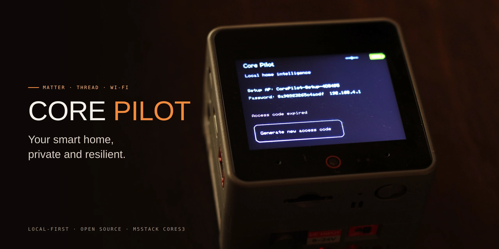

# Core Pilot



Core Pilot turns an M5Stack CoreS3 into a private, local-first control panel for your smart home. The device hosts its own touchscreen experience and web dashboard, so everyday control stays on your local network rather than depending on a cloud service.

## What Core Pilot can do

- Control compatible Matter devices from the CoreS3 and a browser.
- Organize devices into rooms and groups.
- Save favorite controls for quick access.
- Create scenes that operate several devices together.
- Build local automations for routine actions.
- Discover, commission, monitor, and remove Matter devices.
- Use a Gateway H2 as an OpenThread radio for Matter-over-Thread devices.
- Store mutable settings and smart-home records encrypted on the SD card.
- Join an existing Wi-Fi network or guide initial setup through a protected setup network.
- Install signed firmware updates from the dashboard.
- Continue providing local controls without relying on AI or an internet connection.

Matter-over-Wi-Fi and Matter-over-Thread are shown as available only when their required services are genuinely ready. Some commissioning and recovery paths are still undergoing hardware validation.

## Dashboard access

Dashboard access starts with physical possession of the CoreS3:

1. Connect your phone or computer to the same local network as Core Pilot.
2. Open the address shown on the CoreS3 display.
3. Enter the one-time access code displayed on the touchscreen.
4. After authorization, that browser remains signed in for up to eight hours.

The one-time code disappears after it is used. Core Pilot does not provide a network command for revealing or regenerating it.

### Authorizing another browser

Authorizing a second browser does not sign out the first one:

1. On the CoreS3, tap **Authorize another browser**.
2. A fresh one-time code appears for five minutes.
3. Open the dashboard in the new browser or browser profile and enter that code.
4. Each browser receives its own independent eight-hour session.

Use the same process after changing browsers, clearing browser data, using a private window, or letting a session expire. Never share dashboard access codes or session tokens.

Core Pilot currently serves the dashboard over the trusted local network using HTTP. Do not expose it directly to the internet or an untrusted network.

## Install a release

Download the assets for the desired version from GitHub Releases:

- `core-pilot-<version>.bin` is the single merged image for first-time installation.
- `core-pilot-<version>-ota.bin` is the signed application image for dashboard updates.
- `core-pilot-<version>-SHA256SUMS` verifies both images.

For a first installation, positively identify the CoreS3 serial port and flash the merged image at offset `0x0`:

```sh
eim run 'python -m esptool --chip esp32s3 --port /dev/cu.usbmodem1201 write-flash 0x0 core-pilot-<version>.bin' v6.0.2
```

Replace `/dev/cu.usbmodem1201` with the confirmed CoreS3 port. Do not assume that the first connected serial device is the correct target.

For an existing installation, open **System** in the dashboard and select the signed OTA image. The CoreS3 only switches to the update after its integrity, signature, version, and boot partition have been verified.

## First run

1. Power on the CoreS3 with its SD card installed.
2. If saved Wi-Fi is unavailable, join the protected setup network identified on the display and open `http://192.168.4.1`.
3. Enter the Wi-Fi details for the local network.
4. After the device joins, open the local dashboard address shown on the display.
5. Authorize the browser with the one-time touchscreen code.

The setup network is intentionally password protected. Do not configure it as an open access point.

## Build from source

### Requirements

- ESP-IDF 6.0.2 managed through [EIM](https://github.com/espressif/esp-idf).
- A Node.js version supported by the dependencies in `web/package-lock.json`.
- npm.
- An M5Stack CoreS3 for installation and hardware testing.

Build the dashboard first because its generated bundle is embedded in the firmware image. The firmware build also builds the ESP32-H2 RCP and embeds its sparse bootloader, partition-table, and application artifacts; missing or stale RCP output fails the build:

```sh
cd web
npm ci
npm run build

cd ../firmware/s3
eim run 'idf.py -B build build' v6.0.2
```

### Flash a development build

Confirm the CoreS3 port before writing anything, then run:

```sh
cd firmware/s3
eim run 'idf.py -B build -p /dev/cu.usbmodem1201 flash' v6.0.2
```

Replace `/dev/cu.usbmodem1201` with the positively identified CoreS3 port. If automatic reset into the ROM downloader is unavailable, use the built-in USB-JTAG path:

```sh
eim run 'python ../../tools/flash_jtag.py build' v6.0.2
```

## Run the dashboard during development

The dashboard can run locally with hot reload:

```sh
cd web
npm ci
npm run dev
```

The development server does not replace device-side authorization or hardware validation. Use an actual CoreS3 when testing pairing, touch controls, storage, networking, updates, or Matter behavior.

## Repository layout

- `firmware/s3/` — CoreS3 application; its build also builds and embeds the Gateway RCP.
- `firmware/h2/` — separately buildable ESP32-H2 OpenThread UART RCP embedded into the signed CoreS3 application.
- `web/` — browser dashboard embedded into the firmware.
- `tools/` — formatting, validation, flashing, and hardware-test helpers.
- `.github/` — continuous integration and signed-release workflows.

## Contributing

Contributions are welcome. Read [`CONTRIBUTING.md`](CONTRIBUTING.md) for setup, coding, testing, security, and pull-request guidance.

Core Pilot is licensed under the terms in [`LICENSE`](LICENSE).
